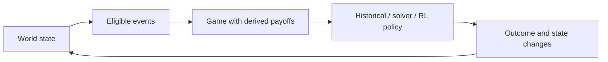
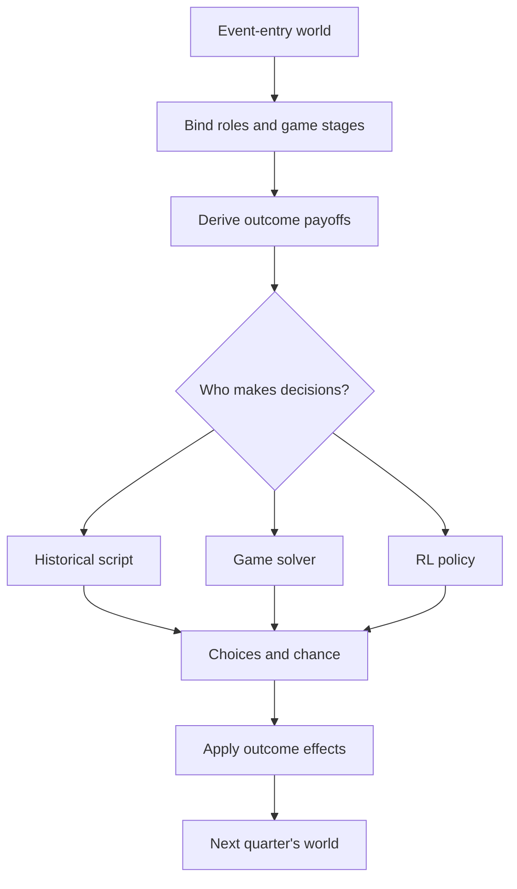

## Contents

1. [Introduction](#1-introduction)
2. [One crisis, step by step](#2-one-crisis-step-by-step)
3. [Modeling the Cold War](#3-modeling-the-cold-war)
4. [Game theory and decision-making](#4-game-theory-and-decision-making)
5. [Game engine and implementation](#5-game-engine-and-implementation)
6. [Reinforcement learning](#6-reinforcement-learning)
7. [Evaluation, assumptions, and limitations](#7-evaluation-assumptions-and-limitations)
8. [Glossary](#8-glossary)

## 1. Introduction

What might have happened if Cold War leaders had made different choices, and if those choices had changed the strategic incentives of every crisis that followed?

This project builds a game-theoretic model of the Cold War from 1945 to 1991. It maintains an evolving world, turns major historical events into strategic games, and lets historical scripts, game-theoretic solvers, or learned policies make decisions. The emphasis is on **counterfactual paths**, not predicting a single alternative history.

The central design principle is that **no event is an island**. The Cuban Missile Crisis has no fixed payoff matrix in this model. Its stakes depend on what each possible outcome would do to each power's goals in the world as it stands in 1962, and that world is itself the product of earlier choices. A concession can be cheap in one campaign and ruinous in another.

The central loop is:

1. **World state:** The current economy, military balance, relationships, regimes, and regional influence determine which events are possible.
2. **Strategic game:** An event supplies the available choices and information structure; the current world supplies the stakes.
3. **Decision-making:** Historical scripts, equilibrium-oriented solvers, or trained agents select actions. Chance and hidden information may matter too.
4. **Feedback:** The outcome changes the world, reshaping the incentives and event triggers in later quarters.

The implementation has three main layers:

- **Generic game kernel:** Players, legal actions, chance, private information, payoffs, and tree solvers, without any Cold War-specific rules.
- **Five game families:** Reusable mechanisms for crises, bargaining, intervention, attrition, and alignment. Historical events configure a family rather than implementing a new game from scratch.
- **Campaign engine:** A quarterly simulation of five powers and 19 regions, connecting playable historical events with leadership changes and other changes to the surrounding world.

A multi-agent RL layer sits on top of the campaign through a PettingZoo environment and a custom PyTorch PPO trainer. An evaluation layer compares learned strategies with game-theoretic references where the games are tractable.

The project is designed around three questions:

- **Counterfactuals:** How do earlier decisions change the incentives and feasible outcomes of later events?
- **Strategic behavior:** What changes when leaders face hidden information, imperfect beliefs, risk, and incentives to escalate?
- **Learning and evaluation:** Can learned policies reproduce well-defined strategic reference behavior, and how do we measure their deviations?

**Important caveat:** Most numerical parameters are modeling judgments, not historical estimates. They are tracked in an assumptions register with plausible ranges, and counterfactual findings are subjected to sensitivity checks. A simulated outcome is a consequence of the model and its assumptions, **not** a claim that history would necessarily have unfolded that way.

## 2. One crisis, step by step

The Cuban Missile Crisis illustrates how the simulator links evolving world conditions, strategic decisions, and lasting consequences.

### Step 1: Arrive at a world shaped by earlier decisions

By 1962, each campaign has developed its own military capabilities, relations, credibility, influence, and tension. The event director checks whether the crisis is eligible under its configured time window and world-state conditions. If it fires, the crisis inherits the world that exists **in that run**.

### Step 2: Turn the event into a game

The crisis family supplies an escalation structure: decision roles, possible private types, signals, noisy intelligence, third-party pressure, accidental escalation, and potentially delegated officers. The event selects and configures the stages it uses.

A player is not omniscient. For example, an officer with a privately determined temperament can face an ambiguous alarm. The leadership may influence the risk of such an incident without directly choosing the officer's response.

### Step 3: Compute the stakes from the current world

For each potential outcome, the engine applies its effects to a copy of the event-entry world and evaluates the resulting change in each power's goals. Those changes feed into payoffs, together with the model's follow-on and terminal terms and, where applicable, risk preferences.

**Illustrative contrast:** Suppose earlier events have left one side with greater credibility and a more favorable military balance. A concession and an escalation may then have different relative values than in a campaign where its position is weaker. The *same event definition* can therefore generate *different strategic incentives*.

### Step 4: Make decisions and resolve uncertainty

A historical script can choose the documented historical actions and chance draws; a game solver can compute a reference policy; or trained agents can make the decisions. Depending on the event configuration, the path may include signals, moves, private information, subordinate decisions, and chance outcomes.

### Step 5: Let the consequences persist

The outcome can alter military and diplomatic conditions, influence, credibility, and the eligibility of later events. The campaign continues instead of resetting to historical facts after the crisis. This is the point of linking otherwise separate historical games: **the consequences of one decision become the context for the next**.

The following sections unpack the representation, mathematics, software, and evaluation behind that loop.

## 3. Modeling the Cold War

The core design question is what to model as a choice, what to leave to chance, and what to script. The campaign uses a bounded world state, evolving goals, and event definitions that respond to that state.

### World state and quarterly dynamics

The campaign runs from **1945-Q3 through 1991-Q4**. Every numeric quantity in the world state has declared bounds.

| Level | What it tracks |
| --- | --- |
| Power | Economy and growth; defense burden; conventional and nuclear forces; nuclear, missile, and space technology; stability, credibility, prestige, posture, leader, and regime |
| Region (19) | Importance, stability, influence shares, controller, and colonial owner |
| Pairwise | A symmetric relation in $[-1,1]$ for each pair of powers |
| Global | Tension, named flags, and active events |

Between events, quarterly dynamics move the world forward. A power's posture splits its budget (economy times defense burden) among reinvestment, conventional forces, nuclear forces, and science. Force stocks obey a discretized arms-race law with depreciation. Science spending advances technology; crossing thresholds triggers milestones such as a first bomb or first satellite.

### Five powers, six political identities

The simulated seats are the United States, Soviet Union, China, United Kingdom, and France. Their opening economic values below are **model inputs normalized to the United States**, not independently estimated figures presented here.

| Power | Opening economy (US = 1) | Opening model setting |
| --- | ---: | --- |
| United States | 1.00 | Truman; nuclear monopoly in 1945; casualty-sensitive as a democracy |
| Soviet Union | 0.35 | Stalin; strongest conventional force; values buffers in Eastern Europe, Germany, and Korea |
| China | 0.12 | Mao begins as an insurgent; the seat may pass to the Nationalists |
| United Kingdom | 0.25 | Attlee; the modeled goal value of empire declines after Suez and 1968 |
| France | 0.15 | Fourth Republic; autonomy becomes a quarter of its goal weight under de Gaulle |

China is one **seat** but can have two **political identities**. If the Communists lose the civil war, the PRC identity exits and the ROC identity takes over the seat, with distinct goals and (in RL training) a distinct policy network.

### What each power values

Each political identity has a goal score: a weighted sum of seven components calculated from world state.

| Component | Meaning in the model |
| --- | --- |
| Security | Own strength against threat-weighted rivals, plus control of buffer regions |
| Influence | Influence in valued regions, relative to rivals |
| Economy | Log growth of GDP since 1945 |
| Regime | Stability of the ruling order |
| Empire | Colonies still held |
| Autonomy | An independently tested bomb and independence from superpower alliances |
| Credibility | Reputation for honoring commitments |

Goal weights change with leaders, dates, or regimes. For example, Stalin's security and economy weights are **0.35** and **0.10**, while Gorbachev's are **0.15** and **0.35**. The quarterly reward uses the current weights on changes in goal components, rather than awarding an instantaneous score jump when the leader changes.

A rival's threat weight is $(1-\mathrm{relation})/2$. Allies can add value within a band of relative strength; in cases supported by the historical model, an ally growing beyond a ceiling becomes a cost, as in Stalin's modeled view of Mao.

### Three levels of decision

- **Yearly strategy:** In the first quarter of each year, every power simultaneously chooses a posture (economy, balanced, conventional, nuclear, or science), a region in which to focus aid or covert action, and a diplomatic initiative toward another power. Strategies are applied only after all choices have been collected.
- **Decision events:** A single power chooses among scripted options at a historical fork.
- **Moves inside major events:** The participating roles make decisions within a crisis, negotiation, intervention, war, or alignment game.

With the optional crisis generator active, yearly focus gains the ability to initiate a regional standoff or sponsor an insurgency. Agents can therefore initiate crises, not just respond to them.

### Five reusable game families

Historical events differ in their details, but many share an underlying strategic problem. The simulator organizes its major events into **five game families**. Each family supplies a reusable decision structure, while the particular event determines who participates, what they know, which actions are available, and how outcomes affect the current world.

These are **modeling abstractions**, not claims that complex historical episodes can be explained by one game-theoretic mechanism alone. The examples below show why each event is represented using its chosen family.

#### Crisis: brinkmanship and escalation

In game theory, a crisis is a **sequential game of threats, signaling, and escalation**. Players try to compel concessions while avoiding an outcome that may be costly for everyone. Because resolve is not fully observable, an action may communicate willingness to fight, or be misinterpreted. Accidents and subordinate decisions can also create risks neither leader intends to take.

The **Cuban Missile Crisis** is the clearest example: the United States and Soviet Union faced successive choices about pressure, concessions, and escalation under the risk of a catastrophic confrontation. The **Taiwan Strait crises** similarly involved threats and military pressure whose credibility mattered. **Suez** is modeled as a crisis because British and French choices unfolded amid pressure from other powers, making escalation and third-party responses central to the outcome.

In the simulator, crisis games can combine private resolve, noisy intelligence, public signals with audience costs, escalation moves, third-party pressure, accidents, and delegated officers. Outcomes can range from a concession or compromise to limited or nuclear war. **The defining mechanism is not that war occurs, but that players bargain through the possibility of escalation.**

#### Bargaining: negotiation under the threat of breakdown

A **bargaining game** asks how players divide a disputed resource or agree on terms when each can reject offers, delay agreement, or accept the risk of breakdown. Credible commitments, deadlines, private information, and the costs of waiting shape which agreements are possible.

The **Korean armistice negotiations** fit this family because talks occurred while fighting continued; delay and battlefield conditions affected what each side would accept. **SALT I** represents bargaining over reciprocal arms limitations. The **Berlin Blockade** is a less obvious example: although it was also a major confrontation, the model emphasizes the negotiation over access, demands, and acceptable terms for ending the blockade. The classification reflects the particular strategic question being modeled, not the full character of the historical event.

The simulator uses alternating offers on a share grid, with a growing risk of breakdown. Depending on the event, it can add hidden resolve, commitments, third-party ratification, or fighting between rounds. The important distinction from a crisis game is that **the negotiated terms themselves are explicit decisions**, rather than primarily the outcome of an escalation ladder.

#### Intervention: whether and how to enter another conflict

An **intervention game** models a power deciding whether to involve itself in another actor's domestic conflict, often with incomplete information about the opposition's strength or the likely costs. A rival may respond by condemning, supporting the other side, or escalating the confrontation.

The **Hungarian Revolution of 1956** and **Prague Spring of 1968** are modeled through decisions about whether and how to suppress political challenges within the Soviet sphere. The **Bay of Pigs invasion** fits because it involved an externally backed effort to change Cuba's government and uncertainty about the strength and response of local forces. These events differ historically, but all involve a consequential decision to intervene in a conflict whose outcome is uncertain.

In the simulator, a patron receives a noisy report about an uprising and chooses a response, while a rival may also act. Outcomes include reform, suppression, defection, a prolonged quagmire, or a wider clash. **The core question is the intervention decision and its consequences**, rather than the detailed course of a long war.

#### Attrition: costly conflict over time

A **war-of-attrition game** studies how long competing parties will continue paying costs in the hope that the other side gives way. The simulator extends this idea with repeated contests for control: sponsors choose effort, military outcomes are uncertain, and accumulating costs can change willingness to continue.

The **Korean War**, **Vietnam War**, and **Soviet-Afghan War** are examples because their outcomes cannot be represented adequately as one decision to fight or withdraw. They involve repeated commitments, changing military conditions, and pressure to negotiate or exit. The **Chinese Civil War** is likewise modeled as a sustained struggle in which the balance of control changes over time.

In the simulator, sponsors make simultaneous, partly hidden effort choices; a contest-success function determines changes in control; and exhaustion can lead to withdrawal. Negotiations can occur while fighting continues. These longer games are too large to solve fully as trees, so reference play relies on approximate lookahead and belief-based policies. **The defining feature is that choices, costs, and control accumulate across rounds.**

#### Alignment: competing offers and strategic partnerships

An **alignment game** models a smaller or less committed actor choosing between competing powers, or remaining neutral, after considering the benefits, restrictions, and risks of each relationship. Game-theoretically, it resembles competition between patrons making offers to attract a client.

The **Marshall Plan** fits because economic assistance also created incentives for European states to participate in a US-led political and economic order. The **Congo Crisis** can be modeled through rival external powers competing for influence over political actors. The **opening to China** is a broader and less literal fit: it concerns a change in strategic relationships between major powers, so the alignment family abstracts the incentives to move closer to one partner and away from another rather than treating China simply as a client.

In the simulator, patrons make offers and the recipient chooses a partner or neutrality; in some settings, an existing controlling power can restrict that choice. **The central outcome is a change in diplomatic orientation**, rather than victory on a battlefield or the settlement of a particular dispute.

### Historical event triggers

The event system is designed so that **historical events respond to the world rather than occurring unconditionally on their historical dates**. Event definitions can specify a time window, conditions, priority, and a probability of occurring. Earlier decisions may therefore enable, delay, or prevent an event. For example, the modeled return of de Gaulle depends on France's regime and the progress of the Algerian War.

**History must remain possible, but is not the target.** Historical replay provides a reference path through supported events. The aim is to keep documented historical choices and outcomes reachable, rather than tune every modeled incentive until the historical path becomes inevitable.

**Effects use a shared contract.** Game families define common effects such as changes in influence, credibility, or the costs of war. Individual events add documented details where necessary. This keeps the strategic mechanism reusable rather than relying on an entirely separate payoff model for each event.

### Procedurally generated crises

The simulator includes an optional **procedural crisis generator**. It uses templates for regional standoffs, proxy wars, uprisings, alignment contests, and settlements. Potential participants are selected from the current distribution of influence and hostility, and their payoffs are derived from the current world instead of manually assigned for each new crisis.

Its hazard rates are informed by the International Crisis Behavior dataset for the Cold War period, with differences by event template, regional group, and decade. Named historical events take priority where relevant. The generator allows new crises to arise as the simulated world diverges from history.

## 4. Game theory and decision-making

The campaign determines *which* games occur and *what is at stake*. Game theory describes how players choose within those games. Every major event is a finite **extensive-form game**: a tree of sequential choices, possibly including chance and information that some players cannot observe. The games are usually **general-sum**, often have more than two players, and do not inherit the convenient convergence guarantees of two-player zero-sum games.

### Turning goals into payoffs

A fixed historical event definition is not assigned one permanent payoff matrix. Instead, each outcome is evaluated against the world at the moment the event begins:

$$
u_p(o) = \kappa\, w_p \cdot \big[c_p(W_o)-c_p(W)\big]
+ \text{follow-ons} + \text{terminal terms}.
$$

Here:

- $W$ is the event-entry world, and $W_o$ is a copy after applying outcome $o$.
- $c_p(W)$ is power $p$'s vector of seven goal components in world $W$.
- $w_p$ contains its current leader's goal weights, and $\kappa$ scales values into payoff units.
- **Follow-ons** incorporate discounted changes in the probability of later scripted events over a **16-quarter** horizon.
- **Terminal terms** represent catastrophic outcomes such as nuclear war or regime loss.

This is the basic bridge from historical state to strategic incentives. The formula describes the derived outcome valuation; crisis and intervention games also apply the risk-attitude machinery described below. Action costs and other family-specific rules can affect the final terminal utility. Keeping those transformations explicit matters when comparing tree solutions with RL rewards.

### Risk attitudes and mistaken beliefs

A leader might react differently to a possible gain than to an equally sized loss. For crisis and intervention outcomes, the model uses a prospect-theory-style value function, with $x$ measured relative to the status quo:

$$
v(x)=
\begin{cases}
 x^{\alpha} & x \ge 0,\\
 -\lambda(-x)^{\beta} & x < 0,
\end{cases}
\qquad \alpha=\beta=0.88,\quad \lambda=2.25.
$$

The selected parameters make losses more salient than corresponding gains. This creates a mechanism through which a leader facing an unfavorable status quo may accept additional risk. It is a modeling choice, **not** proof that any historical leader followed this precise function.

Some crises also allow a player to hold an incorrect prior about a rival's resolve. Each player may act according to a strategy computed for the game it *believes* it is playing. A strategy can therefore be sensible under the player's beliefs while exploitable in the actual game. The evaluation layer can measure that gap.

### Information sets and perfect recall

A game state reports the acting role (or chance/terminal), its legal actions, and each role's **information state**. The information state is the log of everything that role has observed, including its own past actions. Two histories that look identical to a role belong to the same **information set**, even if the full game state differs.

For example, an officer who receives an ambiguous warning may know the warning and their earlier actions without knowing the underlying threat. The solver must give the officer one strategy for all histories it cannot distinguish. Because the log retains the role's own decisions and observations, the game representation has perfect recall by construction.

### Solvers and their guarantees

Different game structures call for different solution methods.

| Method | Used for | Interpretation |
| --- | --- | --- |
| Backward induction | Perfect-information finite trees | A pure subgame-perfect policy, with deterministic tie breaking |
| CFR+ | Imperfect-information trees | An average strategy with measured deviation incentives |
| Exact best responses | Tractable trees with perfect recall | Each role's optimal unilateral deviation against a fixed profile |
| Agent-form logit QRE | Tree games | A noisy-response strategic reference, computed numerically where necessary |
| Belief-grid dynamic programming | Bargaining with hidden resolve | A belief-based approximation to equilibrium behavior |

**Backward induction** works from terminal outcomes toward the root. With perfect information, the acting player can choose the best continuation at each node.

**CFR+** is useful when decision-makers do not know the full history. It repeatedly updates strategies using accumulated *regret*: how much better an action would have performed relative to the actions selected. The implementation uses regret matching+, alternating updates, and linearly weighted averaging. CFR's usual Nash convergence guarantees require two-player zero-sum games; they do **not** generally apply to these multiplayer, general-sum games. The resulting strategies are therefore evaluated using deviation incentives rather than assumed to be equilibria.

### NashConv and off-path incentives

A policy profile is strategically stable if no one can improve by changing only their own policy while all others remain fixed. **NashConv** sums those potential improvements:

$$
\operatorname{NashConv}(\pi)
= \sum_i \left[
\max_{\pi_i'} u_i(\pi_i',\pi_{-i}) - u_i(\pi)
\right].
$$

A value of **zero** characterizes a Nash equilibrium (assuming the maximizations cover all allowed deviations). On tractable trees, best responses are computed exactly, accounting for the relative reach of histories within information sets. A smaller NashConv is better, but its practical significance also depends on the **payoff scale**.

NashConv is an *ex ante* measure: behavior at information sets reached with zero probability may not affect the score. To examine the credibility of off-path threats, the evaluation also reports **sequential regret**, which asks how much a player would prefer to change its action *conditional on reaching a particular information set*.

The solver additionally supports **trembles**: epsilon-perturbed strategies that assign positive probability to every available action during traversal. This exposes off-path information sets and can improve evaluation of conditional incentives, but trembles alone do **not** establish a sequential equilibrium or guarantee that all non-credible threats have disappeared.

### Quantal response equilibrium: a model of imperfect optimization

Nash equilibrium assumes that strategies are mutual best responses. In the default **reference play**, the model instead uses the agent-form **logit quantal response equilibrium (QRE)** of McKelvey and Palfrey. Better-valued actions are *more likely*, rather than always chosen:

$$
\pi(a\mid I)
= \frac{\exp\!\left(Q(I,a)/\tau\right)}
{\sum_{a'} \exp\!\left(Q(I,a')/\tau\right)}.
$$

Here $Q(I,a)$ is the value of action $a$ at information set $I$, and $\tau$ is a **temperature**. As temperature decreases, choice becomes closer to a best response; as it increases, choices become more uniform.

QRE serves as the reference model for three reasons:

1. Near-tied choices become meaningful mixtures instead of brittle pure actions.
2. Every available action has positive probability at positive temperature, which helps define behavior and beliefs on rarely visited branches.
3. Imperfect optimization is a useful behavioral modeling assumption for leaders in uncertain crises.

For perfect-information trees, the logit response can be computed by a bottom-up pass. With imperfect information, the numerical solver starts at a high temperature, cools geometrically toward the target, and applies damped fixed-point updates. Damping is reduced when an update grows too large. This is a **numerical procedure for finding a QRE reference**, not a general guarantee that the procedure finds a unique equilibrium for every game.

### Contests and the arrival of crises

The model also needs stochastic rules for outcomes and event frequency.

Battles and uprisings use a **Tullock contest-success function**: the probability of side $A$ gaining ground rises with its effort $E_A$ relative to its opponent's effort $E_B$.

$$
P(A\text{ gains})
=\frac{E_A^{\gamma}}{E_A^{\gamma}+E_B^{\gamma}}.
$$

The optional generator uses a log-linear crisis hazard based on regional features such as instability, contested influence, and global tension:

$$
h=\min\!\left(
 h_{\max},\;
 r\,g_{\mathrm{group}}\,d_{\mathrm{decade}}
 \exp\!\left[\sum_k\beta_k(x_k-\bar{x}_k)\right]
\right).
$$

The factors $r$, $g_{\mathrm{group}}$, and $d_{\mathrm{decade}}$ set the baseline frequency and group/decade adjustments; the exponential term changes that hazard with current world conditions. A fixed crisis script therefore need not occur in every campaign, and the generator can create new crises as the geopolitical state changes.

## 5. Game engine and implementation

The software is effectively **two nested state machines**: the generic game kernel handles one strategic encounter, while the campaign orchestrates those encounters and advances the surrounding world. Both are designed to be reproducible from a seed and copyable for counterfactual comparisons.

### Generic game kernel

The interface follows the shape of OpenSpiel. A `Game` produces an initial `GameState`; that state exposes the current player, legal actions, chance outcomes, each role's information state, observations, returns, and `clone`.

Game families inherit a logged state. Every observation or action is recorded along with the set of roles allowed to see it, so private information is handled through the logging system rather than separate solver-specific logic.

Solvers do not search live campaign objects. The kernel expands a game once into a compact, depth-first tree whose nodes are stored in preorder. Every child has a higher index than its parent, so bottom-up computations require one reverse pass. Expansion checks chance distributions and information-set consistency and stops at a **500,000-node** budget.

### The quarterly campaign loop

Each quarter has six phases:

1. **Director:** Determine which configured events fire.
2. **Strategic:** In the first quarter of the year, collect each power's simultaneous annual choices.
3. **Subgames:** Advance active strategic games.
4. **Resolve:** Apply game outcomes and committed strategies to world state.
5. **Dynamics:** Evolve economies, forces, technology, influence, relations, and tension.
6. **Rewards:** Credit each political identity with its change in goal score.

The engine advances automatically until an agent must make a decision, then pauses at that choice. Computer-controlled powers, computer-controlled roles, and decisions with only one legal option resolve internally. Every choice, from a yearly posture to a move during a crisis, is represented as an index into a labeled list of options.

### Event director and data-driven content

The director scans events in priority order. An event can fire only when it has not already occurred, no excluded event has occurred, its date falls inside its window, its conditions hold, and its hazard draw passes. Because effects can satisfy additional conditions, the scan repeats until no further event fires.

Events, powers, regions, leaders, goals, the crisis generator, and the effects contract are stored in **YAML**. Two small declarative languages make this possible:

- **Conditions:** Dates, flags, previous outcomes, leaders and regimes, numeric comparisons on world-state paths, and recent strategy.
- **Effects:** Set or clear flags, add to or scale values, shift influence, change relations or tension, swap leaders or regimes, start an event, or run a lottery.

The catalog is validated at load time against a JSON schema. Referenced paths and identifiers are checked, each major event is built once against the opening world, and historical choices are checked against the relevant action sets. The aim is to catch a misspelled field at startup rather than deep into a campaign.

### Binding games to the current world

When an event fires, the engine takes its family configuration, derives payoffs from the current goal system, applies leader traits to risk parameters, and instantiates the game. For a long-running attrition war, a leadership change can trigger rebinding of the affected power's configuration.

This separation is important: **event content specifies the mechanism; world state determines its incentives**. It also means one solver implementation can be reused across many historical and generated situations.

### Reproducible randomness and counterfactual snapshots

Two design choices make comparisons more controlled:

- **Independent subgame streams:** Each game gets a random stream keyed by event ID, so reordering or adding other games does not shift its random draws.
- **Counter-based event randomness:** The director's hazards and lotteries use uniforms keyed by seed, event, and quarter, instead of relying on the order in which random calls happen.

This supports **common random numbers**: competing policies can be tested on the same seeds and matching potential event shocks. It reduces noise in comparisons, but does **not** mean every policy experiences the same realized history. Different actions can enable, suppress, or redirect future events.

All mutable campaign information lives in one state object, allowing deep-copy snapshots. A scenario can start from a captured world at the moment an event begins and replay it under different policies. The catalog also supports **rails**: events outside the current playable tier use historical choices and chance, allowing the playable set to grow without removing the rest of the timeline.

### Tooling

The command-line tooling supports catalog validation, full campaigns, single-event solves, goal inspection, branch audits, assumption sweeps, generator fitting, RL training, and evaluation. The repository has an automated test suite and uses strict `mypy` type checking.

## 6. Reinforcement learning

The learning stack trains policies through self-play on either a captured historical scenario or the entire campaign. Its key advantage is that, for tractable event trees, learned behavior can be evaluated against **solutions of the very game on which it was trained**, instead of being judged only by win rates or plausibility.

### Environment and modes

A thin PettingZoo `AECEnv` adapter exposes the campaign through the agent-environment-cycle interface. Agents act in turn; each action is an option index and is constrained by a legal-action mask.

There are six learning identities: **USA, USSR, PRC, ROC, UK, and FRA**. If the Communists lose China's civil war, the PRC policy exits with a regime-loss penalty and the ROC policy takes over the China seat.

| Mode | Episode | Reward design |
| --- | --- | --- |
| Scenario | A single major event from a captured entry state | The event payoff at termination, including applicable action costs |
| Campaign | The full 1945–1991 campaign | Quarterly changes in weighted goals |

Scenario training is organized around the event's terminal utility rather than a separate win/loss score. Direct comparison with a game-theoretic solution depends on consistent treatment of action costs, family-specific risk transformations, follow-on terms, and terminal penalties.

### Observations and information sets

The policy receives a fixed-width numeric observation. It knows its own state exactly but receives only public fields about other powers. Additional context describes its pending decision and the current game's observable summary.

An early representation was insufficient: two distinct information sets could map to the same observation, forcing a neural policy to choose identically when the game allowed different behavior. The revised input appends recent visible log tokens as embedded hashed categorical IDs, giving the policy more of its information history.

This **reduces observation aliasing**, but does not guarantee a unique representation for every information set: a finite token window or hash collision can still map distinct histories to the same input. The evaluation therefore tracks observation aliasing explicitly.

### Networks, masks, and credit assignment

Each political identity has its own actor-critic network and can play any role associated with its power in an event. Numeric features use running-statistics normalization; log-token IDs use learned embeddings; invalid actions are masked out of the policy logits.

Scenario rewards arrive at the end of events and are credited to each agent's last decision. Advantage estimates use GAE over that agent's own decision sequence, with **no reward discounting** and $\lambda=0.95$.

### Why the PPO objective targets QRE

Ordinary self-play PPO can learn strategies that perform well against current opponents without approaching a particular equilibrium. It can also neglect branches that are rarely visited. In one Suez experiment, for example, a committed Moscow never learned to intervene.

The default training objective instead aims at the same **entropy-regularized response** used in the game's logit QRE reference. At an information set, the desired choice rule solves:

$$
\max_{\pi}\left[
\sum_a \pi(a)Q(a)+\tau H(\pi)
\right]
\quad\Longrightarrow\quad
\pi(a)\propto\exp\!\left(Q(a)/\tau\right).
$$

This relationship motivates the trainer's implementation:

- **Unscaled payoffs:** Rewards remain in the event's payoff units.
- **Unnormalized advantages:** Advantage normalization would change the effective relationship between value and entropy temperature.
- **Temperature as entropy coefficient:** Entropy is weighted by the same $\tau$ used in the reference choice rule.
- **Huber value loss:** Ordinary prediction errors are treated quadratically, while very large errors (such as those caused by catastrophic payoffs) have a linear penalty.

The desired fixed point corresponds to QRE when the response values and opponent policies are mutually consistent. That is a **target and design rationale**, not a guarantee that finite-sample PPO self-play converges to QRE.

Training follows the solver's high-to-low-temperature path; the learning rate subsequently decays to reduce wandering around sharp, low-temperature responses.

### Variance reduction for rare outcomes

In crisis games, rare catastrophic outcomes can dominate return variance. A single sampled nuclear-war outcome can overwhelm updates from many ordinary episodes.

The trainer can instead integrate over chance and computer-controlled stretches of a tractable event tree, weighting possible continuations by their probability rather than relying exclusively on sampled outcomes. This can deliver a much less noisy learning signal.

### Self-play, league opponents, and learned best responses

All political identities train concurrently while computer-run roles use reference play. Two mechanisms help guard against artifacts of self-play:

- **League snapshots:** Every $K$ iterations, current network weights join a pool. Some episodes train against older versions so policies cannot rely solely on conventions that work against their latest opponents.
- **Learned best responses:** One identity trains against a frozen checkpoint while all other identities remain fixed. Its gain is compared on common random seeds with paired standard errors.

For long wars or campaigns that cannot be fully expanded, the gain achieved by a learned deviator is a **lower bound on the best possible deviation gain**, not proof of a small true exploitability value.

### CPU training and caching

Rollout computation is the expensive, CPU-bound portion; network updates are comparatively small. Training therefore uses multiple worker processes, each with one core, including **Oracle Cloud Ampere** instances priced per core.

A major cost is solving event trees for computer-run reference policies. Solves are cached within workers using the bound configuration, with derived numerical values rounded to increase cache hits. In the reported configuration, a cold campaign episode takes about **100 seconds**, compared with about **5 seconds** for a cached warm episode. Workers persist across iterations to retain those caches.

## 7. Evaluation, assumptions, and limitations

The simulator has three separate questions to answer: **Does the software implement its rules correctly? Do its strategies make sense within those rules? And how sensitive are its conclusions to uncertain historical and behavioral assumptions?** Evidence for one does not establish the others.

### Implementation validation

Catalog validation, tests, strict type checking, deterministic seeds, and historical replay assess the **software and representation**. They are intended to catch broken transitions, inconsistent information sets, unintended dependence on evaluation order, and historical choices that are unavailable in the modeled game. They do not establish that the payoffs or counterfactual trajectories are historically realistic.

### Strategic evaluation

For tractable tree events, learned policies can be evaluated directly on the game's tree and compared with reference policies, numerical QRE, and exact equilibrium solutions where an appropriate solver and game structure permit them.

| Metric | What it checks |
| --- | --- |
| **NashConv / deviation gain** | Total improvement players could obtain through unilateral best responses |
| **QRE distance** | Mean total variation between the learned policy and the numerical QRE reference, weighted by QRE reach |
| **Sequential regret** | Largest improvement available at a particular information set, conditional on reaching it |
| **Path regret** | Conditional regret across information sets, weighted by QRE reach |
| **Observation aliasing** | Whether distinct information sets are mapped to the same policy observation |

NashConv measures incentives from the start of the game, so low overall deviation gain can coexist with poor behavior in rarely reached branches. Sequential regret is a separate diagnostic for those branches. It was added after a Suez solution relied on a British threat that Washington never tested.

For attrition wars and full campaigns that cannot be solved exactly, **learned best responses** search for profitable deviations against fixed opponents. The gains they find are lower bounds on possible deviation gains; failing to find a better response does not prove equilibrium.

### Assumptions and sensitivity

Many numerical inputs are modeling judgments rather than direct historical estimates. The **assumptions register** records each hand-set value, its basis (**data, literature, calibration, or judgment**), its plausible range, and the systems it affects. Sensitivity analysis then examines which conclusions depend on those choices.

- **Event sweeps** move relevant parameters to the ends of their plausible ranges, re-solve an event, and rank changes in its outcome distribution by total variation.
- **Campaign robustness runs** sample complete parameter settings, compare trajectories using matched random seeds when possible, and check whether an identified finding persists.
- **Strategy audits** test whether a single yearly doctrine dominates across settings, which would undermine the intended strategic tradeoffs.

A finding is labeled **robust** when it persists in at least **90% of sampled parameter draws**, and **fragile** otherwise. This is a reporting threshold defined over the chosen assumption ranges, not a probability that a particular alternative history is true. Historical-outcome reachability checks and the generated-crisis base-rate fit provide additional plausibility checks, but neither independently validates the modeled incentives.

### Limitations and interpretation

- **Subjective parameters:** Leader preferences, effect sizes, starting values, and risk parameters are partly judgment-based. Their influence must be assessed through the assumptions register and sensitivity analyses.
- **General-sum solution guarantees:** CFR+ has no general Nash-convergence guarantee in these games. Numerical QRE calculations can depend on fixed-point convergence, tolerances, and the solution path. Report deviation incentives and numerical diagnostics rather than treating every reference as exact.
- **Off-path incentives:** Small ex ante deviation gains do not guarantee credible strategies at unvisited information sets. Trembles and conditional-regret checks are useful diagnostics, not automatic proofs of sequential equilibrium.
- **Large-game tractability:** Long attrition games and the full campaign do not have exact computed equilibria. Learned best responses can reveal exploitable policies but cannot establish a tight upper bound on exploitability.
- **Observation fidelity:** Truncated logs or hashed representations can alias distinct information sets unless uniqueness is established or checked.
- **Reward consistency:** Comparing an RL policy to an event-tree solution requires the scenario reward to match the solver's utility, including applicable costs, risk transformations, follow-on effects, and terminal penalties.

The resulting counterfactuals are best interpreted as **conditional comparisons within a specified model**, with uncertainty tied to the assumptions that produce them.

## 8. Glossary

| Term | Meaning in this project |
| --- | --- |
| **Power / seat** | One of the five positions in the campaign world; China remains one seat across regime changes |
| **Political identity** | The regime-specific actor that has goal weights and an RL network; PRC and ROC are distinct identities |
| **Role** | A decision-maker within a specific event; an officer can be a distinct role even if associated with a larger power |
| **Information set** | Histories a role cannot distinguish using its own observations |
| **Policy** | A rule assigning probabilities to legal actions given the information available |
| **Reference play** | The modeled comparison policy, normally based on a numerical logit QRE rather than necessarily a Nash equilibrium |
| **Best response** | The strongest unilateral deviation against a fixed set of opponents' policies |
| **NashConv** | Total potential gain from unilateral best responses; zero at Nash equilibrium |
| **Counterfactual campaign** | A trajectory generated after changing decisions or policies while letting later world conditions evolve |

