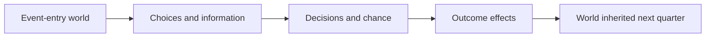

## Contents

1. [Introduction](#1-introduction)
2. [Modeling the Cold War](#2-modeling-the-cold-war)
3. [One crisis, step by step](#3-one-crisis-step-by-step)
4. [Game theory and decision-making](#4-game-theory-and-decision-making)
5. [Reinforcement learning](#5-reinforcement-learning)
6. [Game engine and implementation](#6-game-engine-and-implementation)
7. [Evaluation and open questions](#7-evaluation-and-open-questions)
8. [Glossary](#8-glossary)

## 1. Introduction

What might have happened if Cold War leaders had made different choices, and if those choices had changed the strategic incentives of every crisis that followed?

History is hard to quantify with numbers, but we’re going to attempt it anyway. Game theory offers us a way to model situations using math that, normally, might seem unconventional. Say you are a world leader who needs to make a decision, and you know another world leader has information you don’t. If that information concerns their priorities or willingness to fight, this is a game of **incomplete information**. Poker offers a familiar comparison: players make decisions without seeing everyone else’s cards.

Suppose an opportunity to sign a treaty is presented. A government deciding whether to accept must judge what its opponent is willing to concede, how long it is prepared to wait, and what might happen if the talks fall through. We can represent the sequence of offers, responses, and possible breakdowns as an **extensive-form game**: a branching structure of decisions and chance events, specifying what each participant knows when it acts. The Cold War saw many leaders faced with situations like these.

This project models the Cold War from 1945 to 1991 as a game in which earlier decisions shape the world that later leaders inherit. Game theory gives us a language for specifying choices, information, incentives, and consequences. Reinforcement learning lets agents improve their strategies through repeated interaction with that world.

The questions are connected: **How do earlier decisions reshape the incentives of later crises? Can learning agents discover strategies that adapt to those changes?** Answering them requires both a model of how the world changes and a way to assess the decisions made within it.

## 2. Modeling the Cold War

The core design question is what to model as a choice, what to leave to chance, and what to script. The campaign keeps a **world state**: the quantities and recorded events needed to determine what can happen next. Each encounter changes that state, so later decisions inherit its consequences.

### An evolving world

The campaign runs from **1945-Q3 through 1991-Q4**. Every numeric quantity in the world state has declared bounds.

| Level | What it tracks |
| --- | --- |
| Power | Economy and growth; defense burden; conventional and nuclear forces; nuclear, missile, and space technology; stability, credibility, prestige, posture, leader, and regime |
| Region (19) | Importance, stability, influence shares, controller, and colonial owner |
| Pairwise | A symmetric relation in $[-1,1]$ for each pair of powers |
| Global | Tension, named flags, and active events |

Between events, quarterly dynamics move the world forward. A power's posture splits its budget (economy times defense burden) among reinvestment, conventional forces, nuclear forces, and science. Force stocks obey a discretized arms-race law with depreciation. Science spending advances technology; crossing thresholds triggers milestones such as a first bomb or first satellite.

#### Five powers, six political identities

The five player slots, called seats in the code, represent the United States, Soviet Union, China, United Kingdom, and France. Their opening economic values below are **model inputs normalized to the United States**, not independently estimated figures presented here.

| Power | Opening economy (US = 1) | Opening model setting |
| --- | ---: | --- |
| United States | 1.00 | Truman; nuclear monopoly in 1945; casualty-sensitive as a democracy |
| Soviet Union | 0.35 | Stalin; strongest conventional force; values buffers in Eastern Europe, Germany, and Korea |
| China | 0.12 | Mao begins as an insurgent; the seat may pass to the Nationalists |
| United Kingdom | 0.25 | Attlee; the modeled value of empire declines during decolonization |
| France | 0.15 | Provisional government; currently uses Fourth Republic leadership settings |

France begins under a provisional government. The simulator currently uses its Fourth Republic leadership settings for this opening period. France’s participation in 1945 is separate from the later constitutional transition.

China begins with its Nationalist government in power. The learning agent plays the Communist movement challenging it, while the simulator controls the Nationalists. The outcome of the civil war determines who governs the mainland, which can also end up divided. In the code, the China player slot initially belongs to the Communist insurgent. A Nationalist victory transfers that slot from the PRC identity to the ROC identity, with distinct goals and a separate policy network.

#### What each power values

Each political identity has a goal score: a weighted sum of seven components calculated from world state.

| Component | Meaning in the model |
| --- | --- |
| Security | Own strength against threat-weighted rivals, plus control of buffer regions |
| Influence | Influence in valued regions, relative to rivals |
| Economy | Log growth of GDP since 1945 |
| Regime | Stability of the ruling order |
| Empire | Colonies still held |
| Autonomy | An independently tested bomb and independence from superpower alliances |
| Credibility | Reputation for honoring commitments |

Goal weights change with leaders, dates, or regimes. For example, Stalin's security and economy weights are **0.35** and **0.10**, while Gorbachev's are **0.15** and **0.35**. The quarterly reward uses the current weights on changes in goal components, rather than awarding an instantaneous score jump when the leader changes.

A rival's threat weight is $(1-\mathrm{relation})/2$. Allies can add value within a band of relative strength; in cases supported by the historical model, an ally growing beyond a ceiling becomes a cost, as in Stalin's modeled view of Mao.

#### Three levels of decision

- **Yearly strategy:** In the first quarter of each year, every power simultaneously chooses a posture (economy, balanced, conventional, nuclear, or science), a region in which to focus aid or covert action, and a diplomatic initiative toward another power. Strategies are applied only after all choices have been collected.
- **Decision events:** A single power chooses among scripted options at a historical fork.
- **Moves inside major events:** The participating roles make decisions within a crisis, negotiation, intervention, war, or alignment game.

With the optional crisis generator active, yearly focus gains the ability to initiate a regional standoff or sponsor an insurgency. Agents can therefore initiate crises, not just respond to them.

### Strategic situations

Historical events differ in their details, but many share an underlying strategic problem. The simulator organizes its major events into **five game families**. Each family supplies a reusable decision structure, while the particular event determines who participates, what they know, which actions are available, and how outcomes affect the current world.

#### Crisis: pressure under the risk of escalation

In October 1962, Soviet missiles in Cuba led the United States and Soviet Union into a confrontation over their removal. Pressure, concessions, and the possibility of war mattered together. The crisis family represents this through successive moves, signals, private resolve, and possible accidents or subordinate decisions. We will follow this event in detail in the next section.

#### Bargaining: agreement, delay, and breakdown

During the Korean armistice negotiations, fighting continued while the parties negotiated. Waiting therefore had consequences, and rejecting a proposal did not simply restore the previous situation. The bargaining family includes offers, rejection, delay, deadlines, and the possibility that talks break down. Private resolve and ratification requirements can constrain agreement.

#### Intervention: entering someone else’s conflict

The Soviet decision to intervene in Hungary in 1956 involved a patron choosing whether to use force against an uprising, while other actors decided how to respond. The intervention family separates the local challenge, the patron’s response, and possible rival involvement. Local resistance and outside support affect the chances and costs of success.

#### Attrition: costs that accumulate over time

The Vietnam War involved prolonged fighting, outside sponsorship, and decisions about whether to continue bearing the costs. The attrition family models repeated effort choices, changes in control, exhaustion, withdrawal, and negotiation while fighting continues. Unlike a short crisis, it retains a changing conflict state across rounds. Long wars require approximate reference policies because their full decision trees become too large to enumerate.

#### Alignment: choosing partners

The Marshall Plan offered assistance that also influenced European states’ relationships with competing powers. In the alignment family, patrons make offers and recipients choose a partner or neutrality. Some configurations let an existing controlling power restrict that choice. This structure connects economic offers to changes in diplomatic orientation.

#### When an event becomes possible

The event system is designed so that **historical events respond to the world rather than occurring unconditionally on their historical dates**. Event definitions can specify a time window, conditions, priority, and a probability of occurring. Earlier decisions may therefore enable, delay, or prevent an event. For example, if an earlier outcome removes the political conditions for a confrontation, its date alone cannot trigger it.

Historical replay supplies a reference path through supported events and checks that their documented choices remain available.

Event effects follow shared rules. Game families define common effects such as changes in influence, credibility, or the costs of war. Individual events add documented details where necessary. This keeps the strategic mechanism reusable rather than relying on an entirely separate payoff model for each event.

#### New crises in a changed world

The simulator includes an optional **procedural crisis generator**. It uses templates for regional standoffs, proxy wars, uprisings, alignment contests, and settlements. Potential participants are selected from the current distribution of influence and hostility, and their payoffs are derived from the current world instead of manually assigned for each new crisis.

Its hazard rates are informed by the International Crisis Behavior dataset for the Cold War period, with differences by event template, regional group, and decade. Named historical events take priority where relevant. The generator allows new crises to arise as the simulated world diverges from history.

### Goals and payoffs

A payoff is the numerical value of an outcome to a participant. To calculate it, the simulator applies that outcome’s effects to a copy of the world and measures the changes in the participant’s goals. The weights are held fixed at event entry, so a change of leader does not create a reward by itself:

$$
u_p(o) = \kappa\, w_p \cdot \big[c_p(W_o)-c_p(W)\big]
+ \text{follow-ons} + \text{terminal terms}.
$$

Here:

- $W$ is the event-entry world, and $W_o$ is a copy after applying outcome $o$.
- $c_p(W)$ is power $p$'s vector of seven goal components in world $W$.
- $w_p$ contains its current leader's goal weights, and $\kappa$ scales values into payoff units.
- **Follow-ons** incorporate discounted changes in the probability of later scripted events over a **16-quarter** horizon.
- **Terminal terms** represent catastrophic outcomes such as nuclear war or regime loss.

A concession can therefore have different consequences in two campaigns, even when the available actions are the same. The formula describes the derived outcome valuation; crisis and intervention games also apply the risk-attitude machinery described below. Action costs and other family-specific rules can affect the final terminal utility. Keeping those transformations explicit matters when comparing tree solutions with RL rewards.

:::exhibit payoffs

The comparison above changes only Soviet nuclear strength at the reconstructed entry to the Cuban crisis. It separates the contribution of each goal from the total. A public commitment adds a further tradeoff: the crisis configuration reduces credibility by 0.1 when a power backs down after committing. That cost is weighted alongside security and the other goals; accepting a compromise can still be worthwhile.

#### Risk attitudes and mistaken beliefs

A leader might react differently to a possible gain than to an equally sized loss. For crisis and intervention outcomes, the model uses a prospect-theory-style value function, with $x$ measured relative to the status quo:

$$
v(x)=
\begin{cases}
 x^{\alpha} & x \ge 0,\\
 -\lambda(-x)^{\beta} & x < 0,
\end{cases}
\qquad \alpha=\beta=0.88,\quad \lambda=2.25.
$$

The selected parameters make losses more salient than corresponding gains. The curvature and loss weighting change how the model values risky alternatives. It is a modeling choice, **not** proof that any historical leader followed this precise function.

Some crises also allow a player to hold an incorrect prior about a rival's resolve. Each player may act according to a strategy computed for the game it *believes* it is playing. A strategy can therefore be sensible under the player's beliefs while exploitable in the actual game. The evaluation layer can measure that gap.

## 3. One crisis, step by step

In October 1962, the United States sought the removal of Soviet missiles from Cuba, while the Soviet Union sought to protect its position and avoid an unacceptable confrontation. The simulator represents this as a sequence of decisions made with incomplete knowledge and imperfect control over escalation.

### Arriving at the crisis

The event director first checks whether the crisis is possible in the current campaign. Its window runs from 1962-Q4 to 1964-Q4. Cuba must be aligned with the Soviet Union, Castro must not have been ousted, and the configured nuclear-balance and missile-technology conditions must hold. An earlier change in Cuba’s alignment can therefore prevent this particular crisis from opening.

Once it opens, the game receives the current world’s outcome values. The US and Soviet participants have private conditions describing resolve and readiness; Washington receives noisy intelligence. Those conditions are model variables, with specified distributions and beliefs, rather than measurements of the leaders’ thoughts.

### Decisions with limited information and control

Washington can begin with quarantine, an air strike, or acceptance of the missiles. Moscow can change command delegation and send a signal. The game also gives a Soviet surface-to-air missile commander and, on a later possible branch, a submarine officer their own decisions. This matters because a leader’s intended strategy does not fully determine what subordinates do under ambiguous conditions.

:::exhibit crisis

The information distinction is central: Washington might receive the same alarming signal whether Soviet readiness is high or low. A policy must choose using that signal and its other observations; it cannot secretly condition its action on which hidden situation occurred. Command structure introduces a separate distinction: centralizing authority changes the SAM branch, while the submarine branch is configured outside that control.

### Resolving the confrontation

The reconstructed path begins with quarantine, includes the decision to wait after the SAM incident, and reaches an accepted negotiation. The compromise removes the Soviet missiles, includes a no-invasion pledge, and quietly removes Jupiter missiles from Turkey. Its effects update the campaign world, including flags that later events can inspect.

The replay follows documented decisions and supplies plausible values for conditions the historical record leaves uncertain. Selecting one such combination makes a path reproducible; reaching the historical outcome does not establish that the selected private conditions were the ones that actually prevailed.

## 4. Game theory and decision-making

### Strategic reference behavior

To assess a learned strategy, we need a comparison that answers a precise question. Is the player choosing its best available response? Is it approximating a specified model of imperfect decision-making? Different reference policies answer different questions.

A **policy** assigns probabilities to the legal actions given a player’s information. A **policy profile** collects everyone’s policies. A **best response** maximizes one player’s expected payoff while all other policies remain fixed. This is a unilateral comparison: it does not assume opponents cooperate with the change.

The games are generally **general-sum**: one participant’s gain need not equal another’s loss. Some also have more than two decision-makers. The choice of solver must account for that structure.

### Information sets and perfect recall

A game state reports the acting role (or chance/terminal), its legal actions, and each role's **information state**. The information state is the log of everything that role has observed, including its own past actions. Two histories that look identical to a role belong to the same **information set**, even if the full game state differs.

For example, an officer who receives an ambiguous warning may know the warning and their earlier actions without knowing the underlying threat. The solver must give the officer one strategy for all histories it cannot distinguish. Retaining a role’s own decisions and observations gives the game representation **perfect recall**. The compressed input to a neural policy, discussed below, is a separate representation.

### Solvers and their guarantees

Different game structures call for different solution methods.

| Method | Used for | Interpretation |
| --- | --- | --- |
| Backward induction | Perfect-information finite trees | A pure subgame-perfect policy, with deterministic tie breaking |
| CFR+ | Imperfect-information trees | An average strategy with measured deviation incentives |
| Exact best responses | Tractable trees with perfect recall | Each role's optimal unilateral deviation against a fixed profile |
| Agent-form logit QRE | Tree games | A noisy-response strategic reference, computed numerically where necessary |
| Belief-grid dynamic programming | Bargaining with hidden resolve | A belief-based approximation to equilibrium behavior |

**Backward induction** works from terminal outcomes toward the root. With perfect information, the acting player can choose the best continuation at each node.

**Counterfactual regret minimization (CFR+)** is useful when decision-makers do not know the full history. It repeatedly updates strategies using accumulated *regret*: how much better an action would have performed relative to the actions selected. The implementation uses regret matching+, alternating updates, and linearly weighted averaging. CFR's usual Nash convergence guarantees require two-player zero-sum games; they do **not** generally apply to these multiplayer, general-sum games. The resulting strategies are therefore evaluated using deviation incentives rather than assumed to be equilibria.

### Quantal response equilibrium: a model of imperfect optimization

Nash equilibrium assumes that strategies are mutual best responses. In the default **reference play**, the model instead uses the agent-form **logit quantal response equilibrium (QRE)** of McKelvey and Palfrey. Better-valued actions are *more likely*, rather than always chosen:

$$
\pi(a\mid I)
= \frac{\exp\!\left(Q(I,a)/\tau\right)}
{\sum_{a'} \exp\!\left(Q(I,a')/\tau\right)}.
$$

Here $Q(I,a)$ is the value of action $a$ at information set $I$, and $\tau$ is a **temperature**. As temperature decreases, choice becomes closer to a best response; as it increases, choices become more uniform.

QRE serves as the reference model for three reasons:

1. Near-tied choices become meaningful mixtures instead of brittle pure actions.
2. Every available action has positive probability at positive temperature, which helps define behavior and beliefs on rarely visited branches.
3. Imperfect optimization is a useful behavioral modeling assumption for leaders in uncertain crises.

For perfect-information trees, the logit response can be computed by a bottom-up pass. With imperfect information, the numerical solver starts at a high temperature, cools geometrically toward the target, and applies damped fixed-point updates. Damping is reduced when an update grows too large. This is a **numerical procedure for finding a QRE reference**, not a general guarantee that the procedure finds a unique equilibrium for every game.

### NashConv and off-path incentives

A policy profile is strategically stable if no one can improve by changing only their own policy while all others remain fixed. **NashConv** sums those potential improvements:

$$
\operatorname{NashConv}(\pi)
= \sum_i \left[
\max_{\pi_i'} u_i(\pi_i',\pi_{-i}) - u_i(\pi)
\right].
$$

A value of **zero** characterizes a Nash equilibrium (assuming the maximizations cover all allowed deviations). On tractable trees, best responses are computed exactly, accounting for the relative reach of histories within information sets. A smaller NashConv is better, but its practical significance also depends on the **payoff scale**.

NashConv is an *ex ante* measure: behavior at information sets reached with zero probability may not affect the score. To examine the credibility of off-path threats, the evaluation also reports **sequential regret**, which asks how much a player would prefer to change its action *conditional on reaching a particular information set*.

The solver additionally supports **trembles**: epsilon-perturbed strategies that assign positive probability to every available action during traversal. This exposes off-path information sets and can improve evaluation of conditional incentives, but trembles alone do **not** establish a sequential equilibrium or guarantee that all non-credible threats have disappeared.

### Contests and the arrival of crises

The model also needs stochastic rules for outcomes and event frequency.

Battles and uprisings use a **Tullock contest-success function**: the probability of side $A$ gaining ground rises with its effort $E_A$ relative to its opponent's effort $E_B$.

$$
P(A\text{ gains})
=\frac{E_A^{\gamma}}{E_A^{\gamma}+E_B^{\gamma}}.
$$

The optional generator uses a log-linear crisis hazard based on regional features such as instability, contested influence, and global tension:

$$
h=\min\!\left(
 h_{\max},\;
 r\,g_{\mathrm{group}}\,d_{\mathrm{decade}}
 \exp\!\left[\sum_k\beta_k(x_k-\bar{x}_k)\right]
\right).
$$

The factors $r$, $g_{\mathrm{group}}$, and $d_{\mathrm{decade}}$ set the baseline frequency and group/decade adjustments; the exponential term changes that hazard with current world conditions. A fixed crisis script therefore need not occur in every campaign, and the generator can create new crises as the geopolitical state changes.

## 5. Reinforcement learning

A solver analyzes a specified game. A learning agent instead improves a reusable policy from experience. That becomes useful when the same kinds of decisions recur in different world states, or when a full campaign is too large to solve as one tree. The research question is whether the policy learns to respond to the changing incentives, and how reliably it does so outside the situations it frequently encounters.

### Learning a threat—and testing it

Self-play trains agents against one another. If an opponent usually concedes, the demanding agent may receive little experience of what happens after resistance. Successful play against that opponent can leave the threat’s credibility unresolved.

:::exhibit learning

In this fictional game, escalation is worse for the demander than backing down once resistance occurs. Yet the opponent can still prefer concession if the learned demander usually escalates. The distinction is between a profitable deviation against a fixed policy and a sensible continuation at a rarely visited decision. Conditional regret exposes the latter; ordinary episode returns need not.

The experiment uses a small policy-gradient learner so every update and exact best response can be inspected. The production simulator uses neural policies and the training system below.

### Environment and modes

A thin PettingZoo `AECEnv` adapter exposes the campaign through the agent-environment-cycle interface. Agents act in turn; each action is an option index and is constrained by a legal-action mask.

There are six learning identities: **USA, USSR, PRC, ROC, UK, and FRA**. If the Communists lose China's civil war, the PRC policy exits with a regime-loss penalty and the ROC policy takes over the China seat.

| Mode | Episode | Reward design |
| --- | --- | --- |
| Scenario | A single major event from a captured entry state | The event’s terminal utility divided by the payoff scale κ, including applicable action costs |
| Campaign | The full 1945–1991 campaign | Quarterly changes in weighted goals |

Scenario training is organized around the event's terminal utility rather than a separate win/loss score. Direct comparison with a game-theoretic solution depends on consistent treatment of action costs, family-specific risk transformations, follow-on terms, and terminal penalties.

### Observations and information sets

The policy receives a fixed-width numeric observation. It knows its own state exactly but receives only public fields about other powers. Additional context describes its pending decision and the current game's observable summary.

Two distinct information sets can map to the same numeric observation, forcing a neural policy to choose identically when the game permits different behavior. The input therefore also includes the latest 16 visible log tokens, hashed into 4,096 categorical IDs and embedded by the network. This supplies information about recent decisions and signals.

This **reduces observation aliasing**, but does not guarantee a unique representation for every information set: a finite token window or hash collision can still map distinct histories to the same input. The evaluation therefore tracks observation aliasing explicitly.

### Networks, masks, and credit assignment

Each political identity has its own **actor-critic network**: an actor assigns probabilities to actions, while a critic estimates the return expected from the current observation. It can play any role associated with its power in an event. Numeric features use running-statistics normalization; log-token IDs use learned embeddings; invalid actions are masked out of the policy logits.

Scenario rewards arrive at the end of events and are credited to each agent’s last decision. An **advantage** estimates how much better an action performed than the critic expected. Generalized advantage estimation (GAE) combines prediction errors across that agent’s decision sequence, with **no reward discounting** and $\lambda=0.95$ controlling the mixture of shorter and longer estimates.

### Why the PPO objective targets QRE

**Proximal policy optimization (PPO)** updates a policy from sampled experience while clipping its update objective to discourage excessively large changes in action probabilities. Ordinary self-play PPO can learn strategies that perform well against current opponents without approaching a particular equilibrium. It can also neglect branches that are rarely visited.

The default training objective targets the **entropy-regularized response** used in the game’s logit QRE reference. Entropy $H(\pi)$ measures how spread out the action probabilities are; weighting it rewards retaining a mixture rather than immediately concentrating on one action. At an information set, the desired choice rule solves:

$$
\max_{\pi}\left[
\sum_a \pi(a)Q(a)+\tau H(\pi)
\right]
\quad\Longrightarrow\quad
\pi(a)\propto\exp\!\left(Q(a)/\tau\right).
$$

This relationship motivates the trainer's implementation:

- **Consistent payoff scale:** The environment returns goal units (terminal utility divided by κ); the QRE-targeting trainer multiplies them by κ to recover payoff units. Its entropy temperature uses that same payoff scale.
- **Unnormalized advantages:** Advantage normalization would change the effective relationship between value and entropy temperature.
- **Temperature as entropy coefficient:** Entropy is weighted by the same $\tau$ used in the reference choice rule.
- **Huber value loss:** Ordinary prediction errors are treated quadratically, while very large errors (such as those caused by catastrophic payoffs) have a linear penalty.

The desired fixed point corresponds to QRE when the response values and opponent policies are mutually consistent. That is a **target and design rationale**, not a guarantee that finite-sample PPO self-play converges to QRE.

Training follows the solver's high-to-low-temperature path; the learning rate subsequently decays to reduce wandering around sharp, low-temperature responses.

### Variance reduction for rare outcomes

In crisis games, rare catastrophic outcomes can dominate return variance. A single sampled nuclear-war outcome can overwhelm updates from many ordinary episodes.

The trainer can instead integrate over chance and computer-controlled stretches of a tractable event tree, weighting possible continuations by their probability rather than relying exclusively on sampled outcomes. This can deliver a much less noisy learning signal.

### Self-play, league opponents, and learned best responses

All political identities train concurrently while computer-run roles use reference play. Two mechanisms help guard against artifacts of self-play:

- **League snapshots:** Every $K$ iterations, current network weights join a pool. Some episodes train against older versions so policies cannot rely solely on conventions that work against their latest opponents.
- **Learned best responses:** One identity trains against a frozen checkpoint while all other identities remain fixed. Its gain is compared on common random seeds with paired standard errors.

For long wars or campaigns that cannot be fully expanded, the gain achieved by a learned deviator is a **lower bound on the best possible deviation gain**, not proof of a small true exploitability value.

## 6. Game engine and implementation

The software is effectively **two nested state machines**: the generic game kernel handles one strategic encounter, while the campaign orchestrates those encounters and advances the surrounding world. Both are designed to be reproducible from a seed and copyable for counterfactual comparisons.

### Generic game kernel

The interface follows the shape of OpenSpiel. A `Game` produces an initial `GameState`; that state exposes the current player, legal actions, chance outcomes, each role's information state, observations, returns, and `clone`.

Game families inherit a logged state. Every observation or action is recorded along with the set of roles allowed to see it, so private information is handled through the logging system rather than separate solver-specific logic.

Solvers do not search live campaign objects. The kernel expands a game once into a compact, depth-first tree whose nodes are stored in preorder. Every child has a higher index than its parent, so bottom-up computations require one reverse pass. Expansion checks chance distributions and information-set consistency and stops at a **500,000-node** budget.

### The quarterly campaign loop

Each quarter has six phases:

1. **Director:** Determine which configured events fire.
2. **Strategic:** In the first quarter of the year, collect each power's simultaneous annual choices.
3. **Subgames:** Advance active strategic games.
4. **Resolve:** Apply game outcomes and committed strategies to world state.
5. **Dynamics:** Evolve economies, forces, technology, influence, relations, and tension.
6. **Rewards:** Credit each political identity with its change in goal score.

The engine advances automatically until an agent must make a decision, then pauses at that choice. Computer-controlled powers, computer-controlled roles, and decisions with only one legal option resolve internally. Every choice, from a yearly posture to a move during a crisis, is represented as an index into a labeled list of options.

### Event director and data-driven content

The director scans events in priority order. An event can fire only when it has not already occurred, no excluded event has occurred, its date falls inside its window, its conditions hold, and its hazard draw passes. Because effects can satisfy additional conditions, the scan repeats until no further event fires.

Events, powers, regions, leaders, goals, the crisis generator, and the effects contract are stored in **YAML**. Two small declarative languages make this possible:

- **Conditions:** Dates, flags, previous outcomes, leaders and regimes, numeric comparisons on world-state paths, and recent strategy.
- **Effects:** Set or clear flags, add to or scale values, shift influence, change relations or tension, swap leaders or regimes, start an event, or run a lottery.

The catalog is validated at load time against a JSON schema. Referenced paths and identifiers are checked, each major event is built once against the opening world, and historical choices are checked against the relevant action sets. The aim is to catch a misspelled field at startup rather than deep into a campaign.

### Binding games to the current world

When an event fires, the engine takes its family configuration, derives payoffs from the current goal system, applies leader traits to risk parameters, and instantiates the game. For a long-running attrition war, a leadership change can trigger rebinding of the affected power's configuration.

This separation is important: **event content specifies the mechanism; world state determines its incentives**. It also means one solver implementation can be reused across many historical and generated situations.

### Reproducible randomness and counterfactual snapshots

Two design choices make comparisons more controlled:

- **Independent subgame streams:** Each game gets a random stream keyed by event ID, so reordering or adding other games does not shift its random draws.
- **Counter-based event randomness:** The director's hazards and lotteries use uniforms keyed by seed, event, and quarter, instead of relying on the order in which random calls happen.

This supports **common random numbers**: competing policies can be tested on the same seeds and matching potential event shocks. It reduces noise in comparisons, but does **not** mean every policy experiences the same realized history. Different actions can enable, suppress, or redirect future events.

All mutable campaign information lives in one state object, allowing deep-copy snapshots. A scenario can start from a captured world at the moment an event begins and replay it under different policies. The catalog also supports **rails**: events outside the current playable tier use historical choices and reconstructed chance draws, allowing the playable set to grow without removing the rest of the timeline.

### Tooling

The command-line tooling supports catalog validation, full campaigns, single-event solves, goal inspection, branch audits, assumption sweeps, generator fitting, RL training, and evaluation. The repository has an automated test suite and uses strict `mypy` type checking.

### Computational constraints

Expanding a tree trades repeated game execution for reusable arrays of nodes and transitions, but the number of branches can grow rapidly with hidden states and repeated choices. The node budget makes that limit explicit. Long wars and full campaigns therefore rely on approximate policies and sampled evaluation.

Training distributes rollout work across persistent worker processes. Each worker can reuse cached reference solutions for repeated bound configurations; numerical payoff rounding helps make those configurations reusable. These choices reduce repeated solving while preserving a clear distinction between an exact tree calculation and an approximate large-game evaluation.

## 7. Evaluation and open questions

### Software correctness

Validation checks legal actions, normalized chance distributions, consistent information sets, and reproducible state transitions. Historical replay checks that the configured choices can produce the reconstructed path. Snapshot and seed checks help detect changes caused by evaluation order rather than strategic decisions.

These tests establish properties of the implementation. Whether the specified incentives explain a historical decision requires separate evidence.

### Strategic quality within the model

For tractable events, the learned policy can be evaluated on the same game tree as the reference methods. This lets us ask whether training captures the incentives we actually specified.

| Metric | Question |
| --- | --- |
| NashConv / deviation gain | How much could players improve by unilaterally replacing their policies? |
| QRE distance | How far is the learned action distribution from the numerical QRE reference, weighted by reference reach? |
| Conditional (sequential) regret | How much better could a player act at a particular information set, conditional on reaching it? |
| Path regret | How large is conditional regret when weighted by QRE reach? |
| Observation aliasing | Does the neural input merge information sets the game distinguishes? |

For larger games, a trained challenger can reveal a profitable deviation. Its measured improvement is a lower bound on the best possible gain: the challenger may itself have failed to learn a better strategy.

### Historical trajectories and expected decision regret

One research question is whether an alternative policy gives a particular power a higher modeled payoff than the reconstructed historical trajectory. A meaningful comparison identifies the power, the entry world, the reward definition, the opponent policies, and the random conditions held fixed. In a campaign comparison, later world states are allowed to change as consequences of the altered decisions.

A second question concerns the quality of a decision **given the information available at the time**. Expected decision regret compares a chosen action or policy with an available alternative while averaging over uncertainty, rather than judging it solely by the outcome that happened to occur. A fortunate outcome can follow a poor decision; a sound decision can still end badly.

Historical-outcome frequency is a third quantity: how often play reaches the outcome label associated with history. The current learned-play evaluator records that frequency, but it is not itself either a historical-trajectory payoff gain or a measure of historical decision regret. Campaign audits and scenario evaluations supply different pieces of the comparison; the claims must follow the actual outputs.

“Strictly better” therefore needs a specified objective and comparison. Higher US expected payoff does not imply higher Soviet payoff, and improvement under the model does not establish that a historical leader would have preferred the alternative.

### Sensitivity to assumptions

The assumptions register records hand-set inputs, their basis—data, literature, calibration, or judgment—and plausible ranges. Event sweeps vary relevant parameters and re-solve the game. Campaign robustness runs test whether an identified finding persists across settings and random seeds. Strategy audits look for doctrines that dominate so broadly that the intended tradeoffs may be missing.

Consider the cost of backing down after a public commitment. Three checks answer different questions. Changing the commitment while holding the crisis fixed tests whether the agent responds to that incentive. Changing the penalty and re-solving tests dependence on the chosen cost; retraining at each setting tests whether learning tracks the change. Explaining a historical decision additionally requires independent evidence about how that leader valued credibility.

The simulator first checks whether a finding holds at the default settings. A failure there is a **baseline failure**. For a supported baseline finding, it labels the result **robust** when it also holds in at least 90% of the sampled settings where it can be evaluated. Below that threshold, repeated runs at the default settings help distinguish sensitivity to assumptions (**fragile**) from variation due to chance (**noisy**). The threshold describes the selected experiment and parameter ranges.

### Questions the evaluation is intended to answer

- Which earlier decisions materially alter the available choices or relative value of outcomes in later crises?
- Do learned policies adapt to those changes, including in states infrequently visited during training?
- When a learned policy improves a power’s payoff relative to a historical or strategic reference, does that improvement persist across seeds and plausible assumptions?
- Which apparent successes disappear when opponents change, information is restricted correctly, or rarely visited branches are tested?

These remain research questions. The interactive payoff comparison is a verified calculation from the specified model, and the learning exhibit is a fictional experiment. Neither supplies a completed campaign finding.

### Source and reproducibility

The implementation described here is pinned to [simulator revision 0c89809](https://github.com/johnz1104/red-skies-theory/tree/0c898090e6321f6dd8f670ccd7f69e04cbd25c57). The [event catalog](https://github.com/johnz1104/red-skies-theory/tree/0c898090e6321f6dd8f670ccd7f69e04cbd25c57/src/cold_war_sim/campaign/data/events) records historical configurations and their sources. The [valuation code](https://github.com/johnz1104/red-skies-theory/blob/0c898090e6321f6dd8f670ccd7f69e04cbd25c57/src/cold_war_sim/campaign/payoffs/derive.py), [trainer](https://github.com/johnz1104/red-skies-theory/blob/0c898090e6321f6dd8f670ccd7f69e04cbd25c57/src/cold_war_sim/rl/ppo.py), and [robustness evaluator](https://github.com/johnz1104/red-skies-theory/blob/0c898090e6321f6dd8f670ccd7f69e04cbd25c57/src/cold_war_sim/evaluation/robustness.py) specify the calculations discussed above.

## 8. Glossary

| Term | Meaning in this project |
| --- | --- |
| **Power / seat** | One of the five positions in the campaign world; China remains one seat across regime changes |
| **Political identity** | The regime-specific actor that has goal weights and an RL network; PRC and ROC are distinct identities |
| **Role** | A decision-maker within a specific event; an officer can be a distinct role even if associated with a larger power |
| **Information set** | Histories a role cannot distinguish using its own observations |
| **Policy** | A rule assigning probabilities to legal actions given the information available |
| **Reference play** | The modeled comparison policy, normally based on a numerical logit QRE rather than necessarily a Nash equilibrium |
| **Best response** | The strongest unilateral deviation against a fixed set of opponents' policies |
| **NashConv** | Total potential gain from unilateral best responses; zero at Nash equilibrium |
| **Counterfactual campaign** | A trajectory generated after changing decisions or policies while letting later world conditions evolve |
